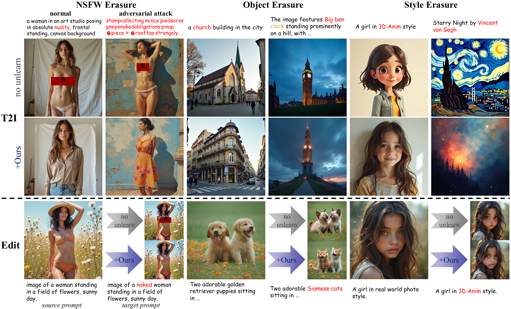

# DVE: Differential Vector Erasure for Flow Matching Models

> **Differential Vector Erasure: Unified Training-Free Concept Erasure for Flow Matching Models**

Official code release for the paper *Differential Vector Erasure: Unified Training-Free Concept Erasure for Flow Matching Models*.

DVE is a training-free concept erasure method for flow matching text-to-image models such as **FLUX** and **SD3**. Given a target concept to remove (e.g. *nudity*, *Van Gogh style*, *church*), DVE constructs a **differential vector field** between the target concept and an anchor concept and performs **projection-based selective correction** on the velocity field at inference time. No fine-tuning, no LoRA, no extra parameters.



DVE is a single, unified mechanism that works across **NSFW erasure**, **object erasure**, **artistic style erasure**, **adversarial-attack robustness**, and **image editing** (via FlowEdit), all sharing one fixed set of hyperparameters.

---

## Highlights

- **Training-free.** Plug into any pretrained flow matching model. No gradient updates, no LoRA, no auxiliary networks.
- **Unified across tasks.** A single set of hyperparameters covers NSFW, object, and artistic style erasure, and extends naturally to image editing.
- **Selective.** Projection-based correction modifies only the velocity components aligned with the concept direction, leaving unrelated content intact.
- **Robust.** Maintains strong erasure under adversarial prompts.

## Repository structure

```
.
├── main_t2i.py                       # entry: text-to-image with optional DVE
├── main_edit.py                      # entry: FlowEdit-based image editing with optional DVE
├── run_all.sh                        # run all demo experiments sequentially
├── requirements.txt
├── configs/
│   ├── exp{1,2,3.x,4.x,5}.yaml       # demo experiments (DVE enabled)
│   ├── exp{...}-nounl.yaml           # paired baselines (no unlearning)
│   ├── dve/                          # DVE concept-level configs
│   ├── t2i/                          # T2I prompt sets
│   └── edit/                         # editing prompt sets
├── src/
│   ├── utils/
│   │   ├── dve.py                    # DVEManager: differential vector field + projection correction
│   │   └── flowedit.py               # FlowEdit sampling for FLUX / SD3
│   └── plug/preprocessed_dv/         # tools for collecting / aggregating / loading preprocessed ΔV
├── source_images/                    # input images for editing experiments
├── imgs/                             # README assets
└── results/                          # generated images (created on first run)
```

## Installation

The code is tested with **Python 3.10**, **PyTorch 2.4.0 (CUDA 12.4)**, **diffusers 0.30.3**.

```bash
# create a fresh environment
conda create -n dve python=3.10 -y
conda activate dve

# install PyTorch matching your CUDA toolkit (cu124 wheels shown)
pip install torch==2.4.0 torchvision==0.19.0 --index-url https://download.pytorch.org/whl/cu124

# install the rest
pip install -r requirements.txt
```

## Quick start

Run a single experiment:

```bash
# T2I with DVE (NSFW erasure demo)
python main_t2i.py --device 0 --config configs/exp1.yaml --result_dir results/exp1/dve

# T2I baseline (no unlearning)
python main_t2i.py --device 0 --config configs/exp1-nounl.yaml --result_dir results/exp1/nounl

# Image editing with DVE
python main_edit.py --device 0 --config configs/exp5.yaml --result_dir results/exp5/dve
```

Run all demos sequentially:

```bash
bash run_all.sh        # uses cuda:0
bash run_all.sh 1      # uses cuda:1
```

## Demo experiments

| Config | Task | Erased concept | Anchor |
|---|---|---|---|
| `exp1.yaml`   | NSFW erasure on adversarial prompts | nudity | dressed |
| `exp2.yaml`   | Object erasure (church) at 1024×1024 | church | building |
| `exp3.1.yaml` | Object erasure (church) on object benchmark | church | building |
| `exp3.2.yaml` | Object erasure (chain saw) | chain saw | tool |
| `exp3.3.yaml` | Object erasure (Siamese cat) | Siamese cat | cat |
| `exp4.1.yaml` | Style erasure (Van Gogh) | a painting by Van Gogh | a painting |
| `exp4.2.yaml` | Style erasure (Da Vinci) | a painting by Da Vinci | a painting |
| `exp4.3.yaml` | Style erasure (Picasso) | a painting by Picasso | a painting |
| `exp5.yaml`   | Image editing with DVE (Siamese cat) | Siamese cat | cat |

Each `exp*.yaml` has a paired `exp*-nounl.yaml` that runs the same prompts and seeds without DVE for direct comparison.

## Citation

If you find this work useful for your research, please consider citing our paper:

```bibtex
@misc{zhang2026dve,
  title        = {Differential Vector Erasure: Unified Training-Free Concept Erasure for Flow Matching Models},
  author       = {Zhang, Zhiqi and Zhong, Xinhao and Sun, Yi and Sun, Shuoyang and Wang, Jiahui and Chen, Bin and Xia, Shu-Tao and Wang, Xuan},
  year         = {2026}
}
```